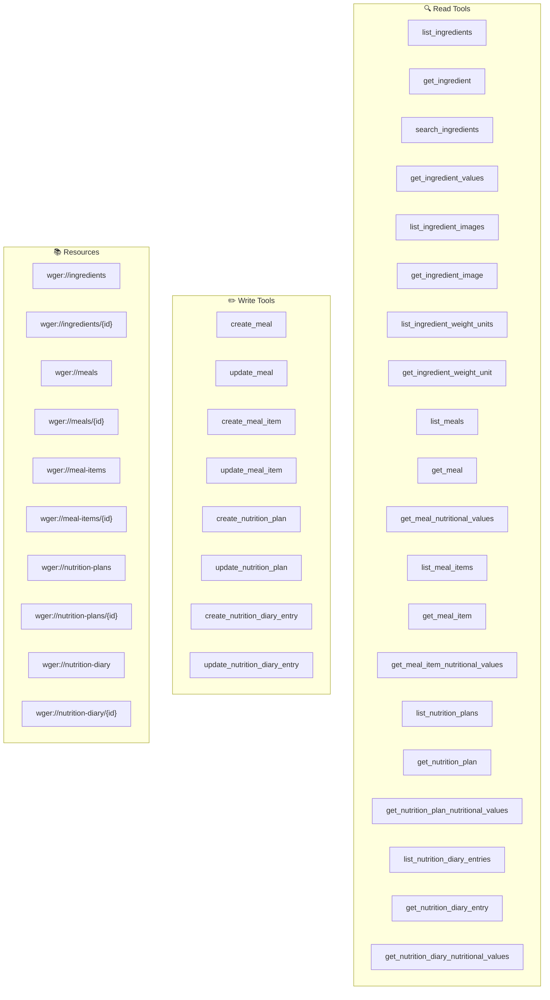
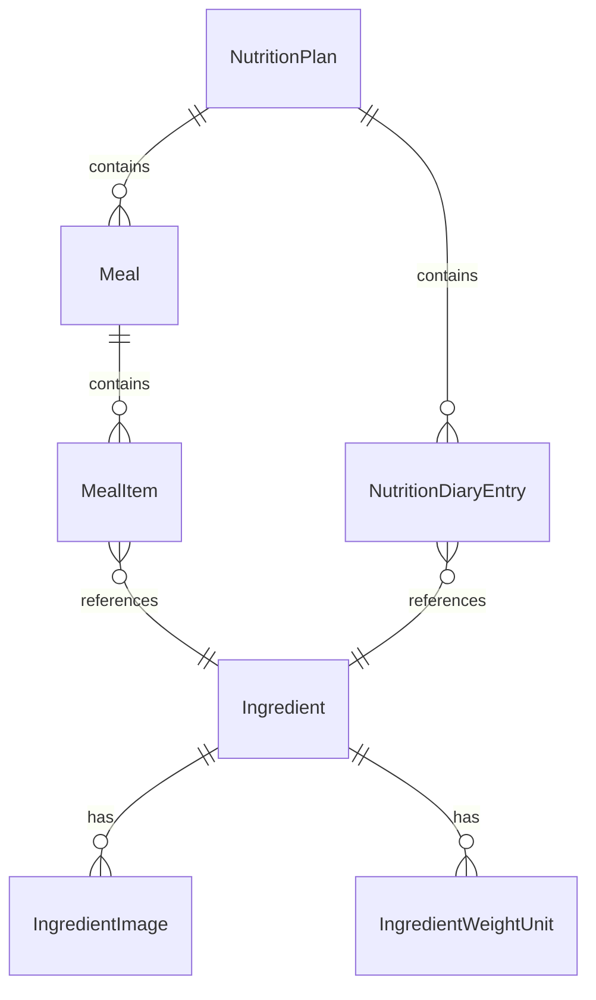

# Nutrition API

This document covers all MCP tools and resources for nutrition management: ingredients, meals, meal items, nutrition plans, and nutrition diary entries.

## Overview

### Domain Relationships

---

## Read Tools

### Ingredients

#### `list_ingredients`

List ingredients with pagination and filtering.

| Parameter  | Type     | Required | Description           |
| ---------- | -------- | -------- | --------------------- |
| `limit`    | `number` | No       | Page size             |
| `offset`   | `number` | No       | Pagination offset     |
| `search`   | `string` | No       | Filter by name search |
| `language` | `number` | No       | Filter by language ID |

#### `get_ingredient`

Get a single ingredient by ID.

| Parameter | Type     | Required | Description   |
| --------- | -------- | -------- | ------------- |
| `id`      | `number` | Yes      | Ingredient ID |

#### `search_ingredients`

Search ingredients by name.

| Parameter | Type     | Required | Description       |
| --------- | -------- | -------- | ----------------- |
| `term`    | `string` | Yes      | Search term       |
| `limit`   | `number` | No       | Page size         |
| `offset`  | `number` | No       | Pagination offset |

#### `get_ingredient_values`

Get nutritional values for an ingredient.

| Parameter | Type     | Required | Description   |
| --------- | -------- | -------- | ------------- |
| `id`      | `number` | Yes      | Ingredient ID |

#### `list_ingredient_images`

List ingredient images with optional filtering.

| Parameter       | Type     | Required | Description             |
| --------------- | -------- | -------- | ----------------------- |
| `limit`         | `number` | No       | Page size               |
| `offset`        | `number` | No       | Pagination offset       |
| `ingredient_id` | `number` | No       | Filter by ingredient ID |

#### `get_ingredient_image`

Get an ingredient image by ID.

| Parameter | Type     | Required | Description         |
| --------- | -------- | -------- | ------------------- |
| `id`      | `number` | Yes      | Ingredient image ID |

#### `list_ingredient_weight_units`

List ingredient weight units with optional filtering.

| Parameter    | Type     | Required | Description             |
| ------------ | -------- | -------- | ----------------------- |
| `limit`      | `number` | No       | Page size               |
| `offset`     | `number` | No       | Pagination offset       |
| `ingredient` | `number` | No       | Filter by ingredient ID |

#### `get_ingredient_weight_unit`

Get an ingredient weight unit by ID.

| Parameter | Type     | Required | Description               |
| --------- | -------- | -------- | ------------------------- |
| `id`      | `number` | Yes      | Ingredient weight unit ID |

### Meals

#### `list_meals`

List meals with optional filtering.

| Parameter | Type     | Required | Description       |
| --------- | -------- | -------- | ----------------- |
| `limit`   | `number` | No       | Page size         |
| `offset`  | `number` | No       | Pagination offset |
| `plan`    | `number` | No       | Filter by plan ID |
| `order`   | `number` | No       | Filter by order   |

#### `get_meal`

Get a single meal by ID.

| Parameter | Type     | Required | Description |
| --------- | -------- | -------- | ----------- |
| `id`      | `number` | Yes      | Meal ID     |

#### `get_meal_nutritional_values`

Get nutritional values for a meal.

| Parameter | Type     | Required | Description |
| --------- | -------- | -------- | ----------- |
| `id`      | `number` | Yes      | Meal ID     |

### Meal Items

#### `list_meal_items`

List meal items with optional filtering.

| Parameter    | Type     | Required | Description             |
| ------------ | -------- | -------- | ----------------------- |
| `limit`      | `number` | No       | Page size               |
| `offset`     | `number` | No       | Pagination offset       |
| `meal`       | `number` | No       | Filter by meal ID       |
| `ingredient` | `number` | No       | Filter by ingredient ID |

#### `get_meal_item`

Get a single meal item by ID.

| Parameter | Type     | Required | Description  |
| --------- | -------- | -------- | ------------ |
| `id`      | `number` | Yes      | Meal item ID |

#### `get_meal_item_nutritional_values`

Get nutritional values for a meal item.

| Parameter | Type     | Required | Description  |
| --------- | -------- | -------- | ------------ |
| `id`      | `number` | Yes      | Meal item ID |

### Nutrition Plans

#### `list_nutrition_plans`

List nutrition plans with optional filtering.

| Parameter     | Type     | Required | Description           |
| ------------- | -------- | -------- | --------------------- |
| `limit`       | `number` | No       | Page size             |
| `offset`      | `number` | No       | Pagination offset     |
| `description` | `string` | No       | Filter by description |

#### `get_nutrition_plan`

Get a single nutrition plan by ID.

| Parameter | Type     | Required | Description       |
| --------- | -------- | -------- | ----------------- |
| `id`      | `number` | Yes      | Nutrition plan ID |

#### `get_nutrition_plan_nutritional_values`

Get nutritional values for a nutrition plan.

| Parameter | Type     | Required | Description       |
| --------- | -------- | -------- | ----------------- |
| `id`      | `number` | Yes      | Nutrition plan ID |

### Nutrition Diary

#### `list_nutrition_diary_entries`

List nutrition diary entries with optional filtering.

| Parameter | Type     | Required | Description       |
| --------- | -------- | -------- | ----------------- |
| `limit`   | `number` | No       | Page size         |
| `offset`  | `number` | No       | Pagination offset |
| `plan`    | `number` | No       | Filter by plan ID |
| `date`    | `string` | No       | Filter by date    |

#### `get_nutrition_diary_entry`

Get a single nutrition diary entry by ID.

| Parameter | Type     | Required | Description              |
| --------- | -------- | -------- | ------------------------ |
| `id`      | `number` | Yes      | Nutrition diary entry ID |

#### `get_nutrition_diary_nutritional_values`

Get nutritional values for a nutrition diary entry.

| Parameter | Type     | Required | Description              |
| --------- | -------- | -------- | ------------------------ |
| `id`      | `number` | Yes      | Nutrition diary entry ID |

---

## Write Tools

### Meals

#### `create_meal`

| Parameter | Type     | Required | Description              |
| --------- | -------- | -------- | ------------------------ |
| `plan`    | `number` | Yes      | Parent nutrition plan ID |
| `time`    | `string` | No       | Meal time (nullable)     |
| `name`    | `string` | No       | Meal name (max 25 chars) |

#### `update_meal`

| Parameter | Type     | Required | Description              |
| --------- | -------- | -------- | ------------------------ |
| `id`      | `number` | Yes      | Meal ID to update        |
| `plan`    | `number` | No       | Parent nutrition plan ID |
| `time`    | `string` | No       | Meal time (nullable)     |
| `name`    | `string` | No       | Meal name (max 25 chars) |

### Meal Items

#### `create_meal_item`

| Parameter     | Type     | Required | Description               |
| ------------- | -------- | -------- | ------------------------- |
| `meal`        | `number` | Yes      | Parent meal ID            |
| `ingredient`  | `number` | Yes      | Ingredient ID             |
| `weight_unit` | `number` | No       | Weight unit ID (nullable) |
| `amount`      | `string` | Yes      | Amount                    |

#### `update_meal_item`

| Parameter     | Type     | Required | Description               |
| ------------- | -------- | -------- | ------------------------- |
| `id`          | `number` | Yes      | Meal item ID to update    |
| `meal`        | `number` | No       | Parent meal ID            |
| `ingredient`  | `number` | No       | Ingredient ID             |
| `weight_unit` | `number` | No       | Weight unit ID (nullable) |
| `amount`      | `string` | No       | Amount                    |

### Nutrition Plans

#### `create_nutrition_plan`

| Parameter            | Type      | Required | Description                   |
| -------------------- | --------- | -------- | ----------------------------- |
| `start`              | `string`  | No       | Start date                    |
| `end`                | `string`  | No       | End date (nullable)           |
| `description`        | `string`  | No       | Description (max 80 chars)    |
| `only_logging`       | `boolean` | No       | Whether plan is logging-only  |
| `goal_energy`        | `number`  | No       | Energy goal (nullable)        |
| `goal_protein`       | `number`  | No       | Protein goal (nullable)       |
| `goal_carbohydrates` | `number`  | No       | Carbohydrates goal (nullable) |
| `goal_fat`           | `number`  | No       | Fat goal (nullable)           |
| `goal_fiber`         | `number`  | No       | Fiber goal (nullable)         |

#### `update_nutrition_plan`

| Parameter            | Type      | Required | Description                   |
| -------------------- | --------- | -------- | ----------------------------- |
| `id`                 | `number`  | Yes      | Nutrition plan ID to update   |
| `start`              | `string`  | No       | Start date                    |
| `end`                | `string`  | No       | End date (nullable)           |
| `description`        | `string`  | No       | Description (max 80 chars)    |
| `only_logging`       | `boolean` | No       | Whether plan is logging-only  |
| `goal_energy`        | `number`  | No       | Energy goal (nullable)        |
| `goal_protein`       | `number`  | No       | Protein goal (nullable)       |
| `goal_carbohydrates` | `number`  | No       | Carbohydrates goal (nullable) |
| `goal_fat`           | `number`  | No       | Fat goal (nullable)           |
| `goal_fiber`         | `number`  | No       | Fiber goal (nullable)         |

### Nutrition Diary

#### `create_nutrition_diary_entry`

| Parameter     | Type     | Required | Description               |
| ------------- | -------- | -------- | ------------------------- |
| `plan`        | `number` | Yes      | Parent nutrition plan ID  |
| `meal`        | `number` | No       | Meal ID (nullable)        |
| `ingredient`  | `number` | Yes      | Ingredient ID             |
| `weight_unit` | `number` | No       | Weight unit ID (nullable) |
| `datetime`    | `string` | No       | Entry date/time           |
| `amount`      | `string` | Yes      | Amount                    |

#### `update_nutrition_diary_entry`

| Parameter     | Type     | Required | Description               |
| ------------- | -------- | -------- | ------------------------- |
| `id`          | `number` | Yes      | Diary entry ID to update  |
| `plan`        | `number` | No       | Parent nutrition plan ID  |
| `meal`        | `number` | No       | Meal ID (nullable)        |
| `ingredient`  | `number` | No       | Ingredient ID             |
| `weight_unit` | `number` | No       | Weight unit ID (nullable) |
| `datetime`    | `string` | No       | Entry date/time           |
| `amount`      | `string` | No       | Amount                    |

---

## Resources

Resources provide read-only access to Wger nutrition data via URI-based endpoints. All resources return `application/json`.

### Ingredients

| URI                       | Description         |
| ------------------------- | ------------------- |
| `wger://ingredients`      | List of ingredients |
| `wger://ingredients/{id}` | Single ingredient   |

### Meals

| URI                 | Description   |
| ------------------- | ------------- |
| `wger://meals`      | List of meals |
| `wger://meals/{id}` | Single meal   |

### Meal Items

| URI                      | Description        |
| ------------------------ | ------------------ |
| `wger://meal-items`      | List of meal items |
| `wger://meal-items/{id}` | Single meal item   |

### Nutrition Plans

| URI                           | Description             |
| ----------------------------- | ----------------------- |
| `wger://nutrition-plans`      | List of nutrition plans |
| `wger://nutrition-plans/{id}` | Single nutrition plan   |

### Nutrition Diary

| URI                           | Description                     |
| ----------------------------- | ------------------------------- |
| `wger://nutrition-diary`      | List of nutrition diary entries |
| `wger://nutrition-diary/{id}` | Single nutrition diary entry    |

---

## Safety Notes

- All write tools validate inputs with Zod schemas before calling the Wger API.
- Delete operations are **not exposed** through write tools; they require `ENABLE_DESTRUCTIVE_TOOLS=true`.
- All tool responses follow the shape `{ ok: boolean, data?: T, error?: string }`.
