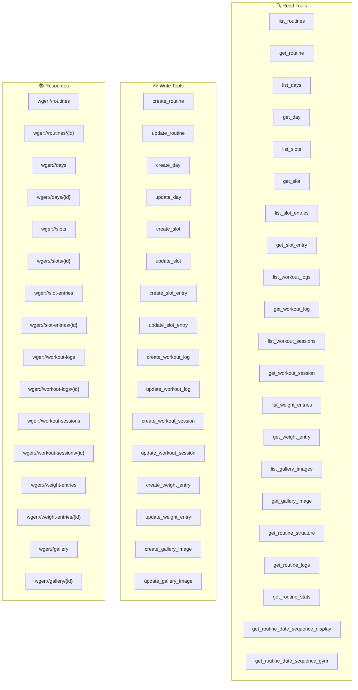

# Workouts, Routines & Body Data API

This document covers all MCP tools and resources for workout routines, training logs, weight tracking, and gallery images.

## Overview

---

## Read Tools

### Routines

#### `list_routines`

List all routines with pagination.

| Parameter | Type     | Required | Description       |
| --------- | -------- | -------- | ----------------- |
| `limit`   | `number` | No       | Page size         |
| `offset`  | `number` | No       | Pagination offset |

#### `get_routine`

Get a single routine by ID.

| Parameter | Type     | Required | Description |
| --------- | -------- | -------- | ----------- |
| `id`      | `number` | Yes      | Routine ID  |

#### `get_routine_structure`

Get the full structure (days, slots, entries) of a routine.

| Parameter | Type     | Required | Description |
| --------- | -------- | -------- | ----------- |
| `id`      | `number` | Yes      | Routine ID  |

#### `get_routine_logs`

Get workout logs associated with a routine.

| Parameter | Type     | Required | Description |
| --------- | -------- | -------- | ----------- |
| `id`      | `number` | Yes      | Routine ID  |

#### `get_routine_stats`

Get aggregated statistics for a routine.

| Parameter | Type     | Required | Description |
| --------- | -------- | -------- | ----------- |
| `id`      | `number` | Yes      | Routine ID  |

#### `get_routine_date_sequence_display`

Get the display-oriented date sequence for a routine.

| Parameter | Type     | Required | Description |
| --------- | -------- | -------- | ----------- |
| `id`      | `number` | Yes      | Routine ID  |

#### `get_routine_date_sequence_gym`

Get the gym-oriented date sequence for a routine.

| Parameter | Type     | Required | Description |
| --------- | -------- | -------- | ----------- |
| `id`      | `number` | Yes      | Routine ID  |

### Days

#### `list_days`

List routine days with optional filtering.

| Parameter | Type     | Required | Description          |
| --------- | -------- | -------- | -------------------- |
| `limit`   | `number` | No       | Page size            |
| `offset`  | `number` | No       | Pagination offset    |
| `routine` | `number` | No       | Filter by routine ID |

#### `get_day`

Get a single day by ID.

| Parameter | Type     | Required | Description |
| --------- | -------- | -------- | ----------- |
| `id`      | `number` | Yes      | Day ID      |

### Slots

#### `list_slots`

List slots with optional filtering.

| Parameter | Type     | Required | Description       |
| --------- | -------- | -------- | ----------------- |
| `limit`   | `number` | No       | Page size         |
| `offset`  | `number` | No       | Pagination offset |
| `day`     | `number` | No       | Filter by day ID  |

#### `get_slot`

Get a single slot by ID.

| Parameter | Type     | Required | Description |
| --------- | -------- | -------- | ----------- |
| `id`      | `number` | Yes      | Slot ID     |

### Slot Entries

#### `list_slot_entries`

List slot entries with optional filtering.

| Parameter | Type     | Required | Description       |
| --------- | -------- | -------- | ----------------- |
| `limit`   | `number` | No       | Page size         |
| `offset`  | `number` | No       | Pagination offset |
| `slot`    | `number` | No       | Filter by slot ID |

#### `get_slot_entry`

Get a single slot entry by ID.

| Parameter | Type     | Required | Description   |
| --------- | -------- | -------- | ------------- |
| `id`      | `number` | Yes      | Slot entry ID |

### Workout Logs

#### `list_workout_logs`

List workout logs with optional filtering.

| Parameter | Type     | Required | Description          |
| --------- | -------- | -------- | -------------------- |
| `limit`   | `number` | No       | Page size            |
| `offset`  | `number` | No       | Pagination offset    |
| `routine` | `number` | No       | Filter by routine ID |
| `date`    | `string` | No       | Filter by date       |

#### `get_workout_log`

Get a single workout log by ID.

| Parameter | Type     | Required | Description    |
| --------- | -------- | -------- | -------------- |
| `id`      | `number` | Yes      | Workout log ID |

### Workout Sessions

#### `list_workout_sessions`

List workout sessions with optional filtering.

| Parameter | Type     | Required | Description       |
| --------- | -------- | -------- | ----------------- |
| `limit`   | `number` | No       | Page size         |
| `offset`  | `number` | No       | Pagination offset |
| `date`    | `string` | No       | Filter by date    |

#### `get_workout_session`

Get a single workout session by ID.

| Parameter | Type     | Required | Description        |
| --------- | -------- | -------- | ------------------ |
| `id`      | `number` | Yes      | Workout session ID |

### Weight Entries

#### `list_weight_entries`

List weight entries with optional date filtering.

| Parameter   | Type     | Required | Description                     |
| ----------- | -------- | -------- | ------------------------------- |
| `limit`     | `number` | No       | Page size                       |
| `offset`    | `number` | No       | Pagination offset               |
| `date__gt`  | `string` | No       | Filter by date greater than     |
| `date__gte` | `string` | No       | Filter by date greater or equal |

#### `get_weight_entry`

Get a single weight entry by ID.

| Parameter | Type     | Required | Description     |
| --------- | -------- | -------- | --------------- |
| `id`      | `number` | Yes      | Weight entry ID |

### Gallery Images

#### `list_gallery_images`

List gallery images with pagination.

| Parameter | Type     | Required | Description       |
| --------- | -------- | -------- | ----------------- |
| `limit`   | `number` | No       | Page size         |
| `offset`  | `number` | No       | Pagination offset |

#### `get_gallery_image`

Get a single gallery image by ID.

| Parameter | Type     | Required | Description      |
| --------- | -------- | -------- | ---------------- |
| `id`      | `number` | Yes      | Gallery image ID |

---

## Write Tools

### Routines

#### `create_routine`

| Parameter     | Type      | Required | Description                      |
| ------------- | --------- | -------- | -------------------------------- |
| `name`        | `string`  | No       | Routine name (max 25 chars)      |
| `description` | `string`  | No       | Routine description (max 1000)   |
| `start`       | `string`  | Yes      | Start date                       |
| `end`         | `string`  | Yes      | End date                         |
| `fit_in_week` | `boolean` | No       | Whether routine fits in one week |
| `is_template` | `boolean` | No       | Whether this is a template       |
| `is_public`   | `boolean` | No       | Whether routine is public        |

#### `update_routine`

| Parameter     | Type      | Required | Description                      |
| ------------- | --------- | -------- | -------------------------------- |
| `id`          | `number`  | Yes      | Routine ID to update             |
| `name`        | `string`  | No       | Routine name (max 25 chars)      |
| `description` | `string`  | No       | Routine description (max 1000)   |
| `start`       | `string`  | No       | Start date                       |
| `end`         | `string`  | No       | End date                         |
| `fit_in_week` | `boolean` | No       | Whether routine fits in one week |
| `is_template` | `boolean` | No       | Whether this is a template       |
| `is_public`   | `boolean` | No       | Whether routine is public        |

### Days

#### `create_day`

| Parameter              | Type      | Required | Description                                                                 |
| ---------------------- | --------- | -------- | --------------------------------------------------------------------------- |
| `routine`              | `number`  | Yes      | Parent routine ID                                                           |
| `order`                | `number`  | No       | Display order                                                               |
| `name`                 | `string`  | No       | Day name (max 20 chars)                                                     |
| `description`          | `string`  | No       | Day description (max 1000)                                                  |
| `is_rest`              | `boolean` | No       | Whether this is a rest day                                                  |
| `need_logs_to_advance` | `boolean` | No       | Whether logs are required to advance                                        |
| `type`                 | `string`  | No       | Day type: `custom`, `enom`, `amrap`, `hiit`, `tabata`, `edt`, `rft`, `afap` |
| `config`               | `unknown` | No       | Type-specific configuration (nullable)                                      |

#### `update_day`

| Parameter              | Type      | Required | Description                                                                 |
| ---------------------- | --------- | -------- | --------------------------------------------------------------------------- |
| `id`                   | `number`  | Yes      | Day ID to update                                                            |
| `routine`              | `number`  | No       | Parent routine ID                                                           |
| `order`                | `number`  | No       | Display order                                                               |
| `name`                 | `string`  | No       | Day name (max 20 chars)                                                     |
| `description`          | `string`  | No       | Day description (max 1000)                                                  |
| `is_rest`              | `boolean` | No       | Whether this is a rest day                                                  |
| `need_logs_to_advance` | `boolean` | No       | Whether logs are required to advance                                        |
| `type`                 | `string`  | No       | Day type: `custom`, `enom`, `amrap`, `hiit`, `tabata`, `edt`, `rft`, `afap` |
| `config`               | `unknown` | No       | Type-specific configuration (nullable)                                      |

### Slots

#### `create_slot`

| Parameter | Type      | Required | Description                   |
| --------- | --------- | -------- | ----------------------------- |
| `day`     | `number`  | Yes      | Parent day ID                 |
| `order`   | `number`  | No       | Display order                 |
| `comment` | `string`  | No       | Slot comment (max 200 chars)  |
| `config`  | `unknown` | No       | Slot configuration (nullable) |

#### `update_slot`

| Parameter | Type      | Required | Description                   |
| --------- | --------- | -------- | ----------------------------- |
| `id`      | `number`  | Yes      | Slot ID to update             |
| `day`     | `number`  | No       | Parent day ID                 |
| `order`   | `number`  | No       | Display order                 |
| `comment` | `string`  | No       | Slot comment (max 200 chars)  |
| `config`  | `unknown` | No       | Slot configuration (nullable) |

### Slot Entries

#### `create_slot_entry`

| Parameter             | Type      | Required | Description                                                                                 |
| --------------------- | --------- | -------- | ------------------------------------------------------------------------------------------- |
| `slot`                | `number`  | Yes      | Parent slot ID                                                                              |
| `exercise`            | `number`  | Yes      | Exercise ID                                                                                 |
| `type`                | `string`  | No       | Entry type: `normal`, `warmup`, `dropset`, `myo`, `partial`, `forced`, `tut`, `iso`, `jump` |
| `repetition_unit`     | `number`  | No       | Repetition unit ID (nullable)                                                               |
| `repetition_rounding` | `string`  | No       | Repetition rounding (nullable)                                                              |
| `weight_unit`         | `number`  | No       | Weight unit ID (nullable)                                                                   |
| `weight_rounding`     | `string`  | No       | Weight rounding (nullable)                                                                  |
| `order`               | `number`  | No       | Display order                                                                               |
| `comment`             | `string`  | No       | Entry comment (max 100 chars)                                                               |
| `config`              | `unknown` | No       | Entry configuration (nullable)                                                              |

#### `update_slot_entry`

| Parameter             | Type      | Required | Description                                                                                 |
| --------------------- | --------- | -------- | ------------------------------------------------------------------------------------------- |
| `id`                  | `number`  | Yes      | Slot entry ID to update                                                                     |
| `slot`                | `number`  | No       | Parent slot ID                                                                              |
| `exercise`            | `number`  | No       | Exercise ID                                                                                 |
| `type`                | `string`  | No       | Entry type: `normal`, `warmup`, `dropset`, `myo`, `partial`, `forced`, `tut`, `iso`, `jump` |
| `repetition_unit`     | `number`  | No       | Repetition unit ID (nullable)                                                               |
| `repetition_rounding` | `string`  | No       | Repetition rounding (nullable)                                                              |
| `weight_unit`         | `number`  | No       | Weight unit ID (nullable)                                                                   |
| `weight_rounding`     | `string`  | No       | Weight rounding (nullable)                                                                  |
| `order`               | `number`  | No       | Display order                                                                               |
| `comment`             | `string`  | No       | Entry comment (max 100 chars)                                                               |
| `config`              | `unknown` | No       | Entry configuration (nullable)                                                              |

### Workout Logs

#### `create_workout_log`

| Parameter            | Type     | Required | Description                   |
| -------------------- | -------- | -------- | ----------------------------- |
| `date`               | `string` | No       | Log date                      |
| `routine`            | `number` | No       | Routine ID (nullable)         |
| `iteration`          | `number` | No       | Iteration (nullable)          |
| `slot_entry`         | `number` | No       | Slot entry ID (nullable)      |
| `next_log`           | `number` | No       | Next log ID (nullable)        |
| `exercise`           | `number` | Yes      | Exercise ID                   |
| `repetitions_unit`   | `number` | No       | Repetitions unit (nullable)   |
| `repetitions`        | `string` | No       | Repetitions value (nullable)  |
| `repetitions_target` | `string` | No       | Target repetitions (nullable) |
| `weight_unit`        | `number` | No       | Weight unit (nullable)        |
| `weight`             | `string` | No       | Weight value (nullable)       |
| `weight_target`      | `string` | No       | Target weight (nullable)      |
| `rir`                | `string` | No       | RIR value (nullable)          |
| `rir_target`         | `string` | No       | Target RIR (nullable)         |
| `rest`               | `number` | No       | Rest seconds (nullable)       |
| `rest_target`        | `number` | No       | Target rest (nullable)        |

#### `update_workout_log`

| Parameter            | Type     | Required | Description                   |
| -------------------- | -------- | -------- | ----------------------------- |
| `id`                 | `number` | Yes      | Workout log ID to update      |
| `date`               | `string` | No       | Log date                      |
| `routine`            | `number` | No       | Routine ID (nullable)         |
| `iteration`          | `number` | No       | Iteration (nullable)          |
| `slot_entry`         | `number` | No       | Slot entry ID (nullable)      |
| `next_log`           | `number` | No       | Next log ID (nullable)        |
| `exercise`           | `number` | No       | Exercise ID                   |
| `repetitions_unit`   | `number` | No       | Repetitions unit (nullable)   |
| `repetitions`        | `string` | No       | Repetitions value (nullable)  |
| `repetitions_target` | `string` | No       | Target repetitions (nullable) |
| `weight_unit`        | `number` | No       | Weight unit (nullable)        |
| `weight`             | `string` | No       | Weight value (nullable)       |
| `weight_target`      | `string` | No       | Target weight (nullable)      |
| `rir`                | `string` | No       | RIR value (nullable)          |
| `rir_target`         | `string` | No       | Target RIR (nullable)         |
| `rest`               | `number` | No       | Rest seconds (nullable)       |
| `rest_target`        | `number` | No       | Target rest (nullable)        |

### Workout Sessions

#### `create_workout_session`

| Parameter    | Type     | Required | Description                  |
| ------------ | -------- | -------- | ---------------------------- |
| `routine`    | `number` | No       | Routine ID (nullable)        |
| `day`        | `number` | No       | Day ID (nullable)            |
| `date`       | `string` | No       | Session date                 |
| `notes`      | `string` | No       | Session notes (nullable)     |
| `impression` | `string` | No       | Impression: `1`, `2`, or `3` |
| `time_start` | `string` | No       | Start time (nullable)        |
| `time_end`   | `string` | No       | End time (nullable)          |

#### `update_workout_session`

| Parameter    | Type     | Required | Description                  |
| ------------ | -------- | -------- | ---------------------------- |
| `id`         | `number` | Yes      | Workout session ID to update |
| `routine`    | `number` | No       | Routine ID (nullable)        |
| `day`        | `number` | No       | Day ID (nullable)            |
| `date`       | `string` | No       | Session date                 |
| `notes`      | `string` | No       | Session notes (nullable)     |
| `impression` | `string` | No       | Impression: `1`, `2`, or `3` |
| `time_start` | `string` | No       | Start time (nullable)        |
| `time_end`   | `string` | No       | End time (nullable)          |

### Weight Entries

#### `create_weight_entry`

| Parameter | Type     | Required | Description  |
| --------- | -------- | -------- | ------------ |
| `date`    | `string` | Yes      | Entry date   |
| `weight`  | `string` | Yes      | Weight value |

#### `update_weight_entry`

| Parameter | Type     | Required | Description     |
| --------- | -------- | -------- | --------------- |
| `id`      | `number` | Yes      | Weight entry ID |
| `date`    | `string` | No       | Entry date      |
| `weight`  | `string` | No       | Weight value    |

### Gallery Images

#### `create_gallery_image`

| Parameter     | Type     | Required | Description                  |
| ------------- | -------- | -------- | ---------------------------- |
| `date`        | `string` | Yes      | Image date                   |
| `image`       | `string` | Yes      | Image data (base64 or URL)   |
| `description` | `string` | No       | Image description (max 1000) |

#### `update_gallery_image`

| Parameter     | Type     | Required | Description                  |
| ------------- | -------- | -------- | ---------------------------- |
| `id`          | `number` | Yes      | Gallery image ID             |
| `date`        | `string` | No       | Image date                   |
| `image`       | `string` | No       | Image data (base64 or URL)   |
| `description` | `string` | No       | Image description (max 1000) |

---

## Resources

Resources provide read-only access to Wger data via URI-based endpoints. All resources return `application/json`.

### Routines

| URI                    | Description      |
| ---------------------- | ---------------- |
| `wger://routines`      | List of routines |
| `wger://routines/{id}` | Single routine   |

### Days

| URI                | Description  |
| ------------------ | ------------ |
| `wger://days`      | List of days |
| `wger://days/{id}` | Single day   |

### Slots

| URI                 | Description   |
| ------------------- | ------------- |
| `wger://slots`      | List of slots |
| `wger://slots/{id}` | Single slot   |

### Slot Entries

| URI                        | Description     |
| -------------------------- | --------------- |
| `wger://slot-entries`      | List of entries |
| `wger://slot-entries/{id}` | Single entry    |

### Workout Logs

| URI                        | Description  |
| -------------------------- | ------------ |
| `wger://workout-logs`      | List of logs |
| `wger://workout-logs/{id}` | Single log   |

### Workout Sessions

| URI                            | Description      |
| ------------------------------ | ---------------- |
| `wger://workout-sessions`      | List of sessions |
| `wger://workout-sessions/{id}` | Single session   |

### Weight Entries

| URI                          | Description            |
| ---------------------------- | ---------------------- |
| `wger://weight-entries`      | List of weight entries |
| `wger://weight-entries/{id}` | Single weight entry    |

### Gallery Images

| URI                   | Description            |
| --------------------- | ---------------------- |
| `wger://gallery`      | List of gallery images |
| `wger://gallery/{id}` | Single gallery image   |

---

## Safety Notes

- All write tools validate inputs with Zod schemas before calling the Wger API.
- Delete operations are **not exposed** through write tools; they require `ENABLE_DESTRUCTIVE_TOOLS=true`.
- All tool responses follow the shape `{ ok: boolean, data?: T, error?: string }`.
