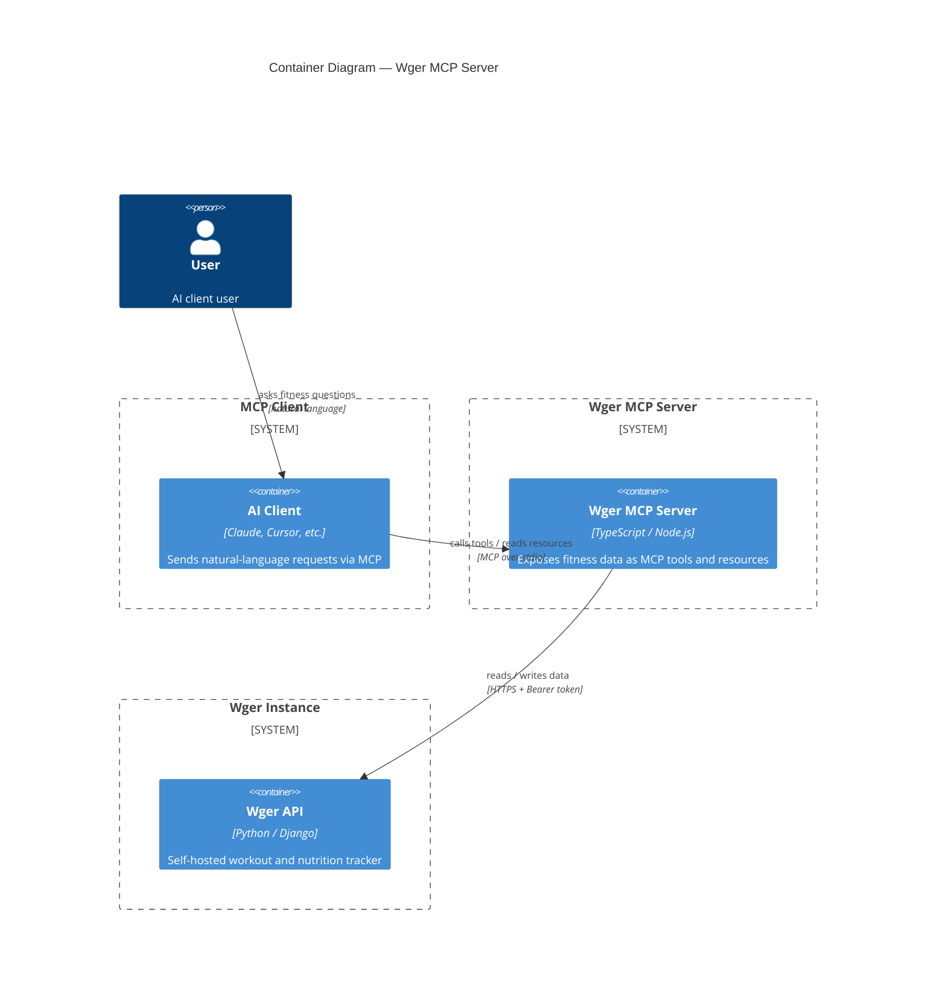
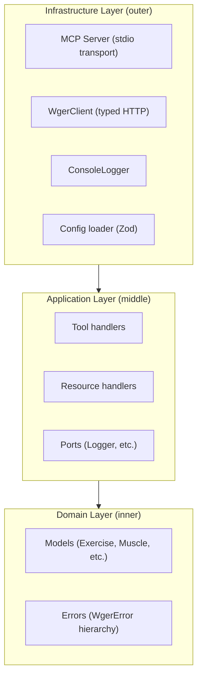
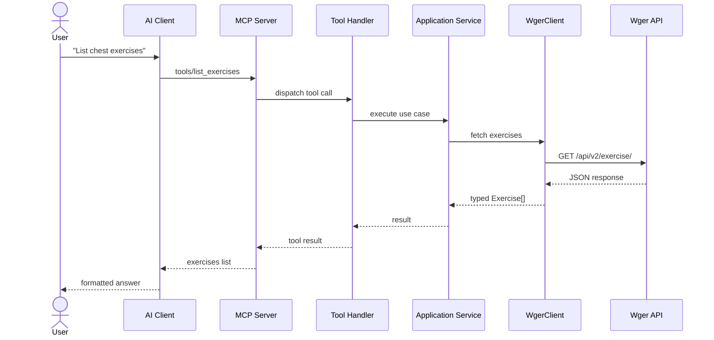

# Architecture

This document describes the high-level architecture of the Wger MCP server.

## C4 Container Diagram

## Clean Architecture Layers

Dependencies point inward. Domain knows nothing about application or infrastructure. Application knows nothing about infrastructure.

## Tool Call Flow

